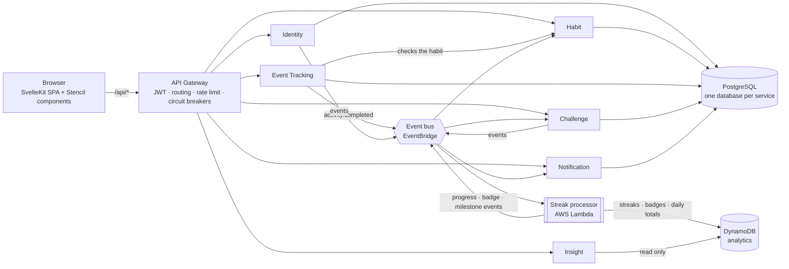
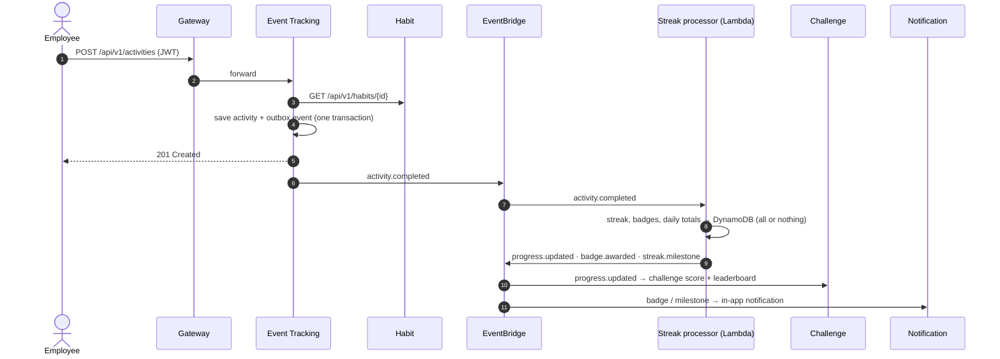

# TeamPulse — Internal Wellness & Consistency Platform

> Case Study 2 · Corporate Wellness and Team Engagement Platform

TeamPulse helps employees build healthy habits and compete in team challenges **without exposing
personal wellness data across the organisation**. Employees track private or team-shared habits, keep
streaks, earn badges and join challenges. Managers see **only aggregated, k-anonymised team trends**.

## Deliverables

| # | Deliverable | Where |
|---|---|---|
| 1 | Source code | this repository |
| 2 | Architecture overview | this README ([Architecture](#architecture)) · full design in [docs/architecture.md](docs/architecture.md) |
| 3 | Setup guide (Docker Compose) | [docs/setup-guide.md](docs/setup-guide.md) |
| 4 | API documentation | [docs/api-documentation.md](docs/api-documentation.md) · OpenAPI files in [docs/openapi/](docs/openapi) · Postman in [postman/](postman) |
| 5 | User walkthrough | [docs/user-walkthrough.md](docs/user-walkthrough.md) |
| 6 | Network architecture diagram | [docs/network-architecture.md](docs/network-architecture.md) · draw.io source in [docs/diagrams/](docs/diagrams) |
| 7 | Cloud deployment documentation | [docs/cloud-deployment.md](docs/cloud-deployment.md) · screenshots in [docs/screenshots/](docs/screenshots) |
| 8 | Demo recording | [docs/demo/](docs/demo) |

## Tech stack

| Layer | Technology |
|---|---|
| Backend | **Python 3.13 · FastAPI** microservices (async SQLAlchemy 2, Pydantic v2), API gateway, AWS Lambda worker |
| Messaging | Transactional outbox + idempotent inbox over **EventBridge + SQS** (AWS), **RabbitMQ** (Docker) or direct HTTP (local without Docker) |
| Data | **PostgreSQL** (Amazon RDS, one database per service) · **DynamoDB** (analytics) |
| Frontend | **SvelteKit + Svelte 5 runes** SPA · **StencilJS** web-component library `@teampulse/ui-components` |
| Ops | Docker Compose, Consul, Jaeger (OpenTelemetry), CloudWatch (JSON logs, metrics, alarms), GitHub Actions |

---

## Architecture

### System design



| Service | What it does (case study) | Data |
|---|---|---|
| `gateway` | Single entry point: checks the JWT, routes `/api/*`, rate-limits logins, one circuit breaker per service, Swagger for all services | — |
| `identity-service` | Employee login, **RS256 JWT + JWKS**, refresh tokens, users, teams, **role-based access** (employee, manager, admin) | PostgreSQL `identity` |
| `habit-service` | **Team-shared and private** wellness goals | PostgreSQL `habits` |
| `event-tracking-service` | **Activity completions**, stored and published as `activity.completed` | PostgreSQL `event_tracking` |
| `streak-processor` (Lambda) | **Streaks, badges, challenge progress**, analytics totals | DynamoDB |
| `challenge-service` | **Team competitions, leaderboards, badge rules** | PostgreSQL `challenges` |
| `insight-service` | **Team and individual analytics**; managers get k-anonymised totals only | DynamoDB (read only) |
| `notification-service` | **Reminders, challenge updates, milestone messages** | PostgreSQL `notifications` |

### How the services interact

**Synchronous (HTTP) — only where the caller needs an answer now**

| Caller → callee | Why |
|---|---|
| Browser → gateway → service | Every user request. The gateway checks the JWT first. |
| event-tracking → habit (`GET /api/v1/habits/{id}`) | Before saving a completion: does the habit exist, belong to the user and is it active? Protected by a timeout, retries and a circuit breaker. |
| Every service → identity (`/.well-known/jwks.json`) | Public key to verify JWTs; cached for 10 minutes. |

**Asynchronous (events) — everything else**

| Event | Published by | Consumed by |
|---|---|---|
| `user.registered` | identity | notification (welcome message, contact details) |
| `user.updated` | identity | notification (contact details), habit (owner name and team) |
| `activity.completed` | event-tracking | streak processor, notification |
| `progress.updated` | streak processor | challenge (updates scores and leaderboards) |
| `streak.milestone`, `badge.awarded` | streak processor | notification |
| `badge_rules.changed` | challenge | streak processor |
| `challenge.created`, `challenge.joined`, `challenge.goal_reached` | challenge | notification |
| `reminder.tick` (hourly) | EventBridge Scheduler | notification (habit reminders) |

Three rules keep events reliable: a **transactional outbox** (the event is saved in the same database
transaction as the change, then published), an **idempotent inbox** (each consumer applies an event
only once, even if it arrives twice), and **dead-letter queues** for messages that keep failing.
Details: [docs/inter-service-communication.md](docs/inter-service-communication.md) and
[docs/events.md](docs/events.md).

### Example: an employee completes a habit



### Security and privacy at a glance

- **Who you are:** RS256 JWT (15 minutes) + rotating refresh token; every service verifies the token itself.
- **What you may do:** role checks in every service (employee, manager, admin); the web app also hides links a role cannot use.
- **Privacy:** managers only get team totals; a day with fewer than 3 active members is hidden (k-anonymity, k = 3). Events carry ids and counts, never habit titles or notes.
- **Network (AWS):** three subnet tiers, security groups and network ACLs, no public IPs on tasks, secrets in Secrets Manager. See [docs/network-architecture.md](docs/network-architecture.md) and [docs/security-and-privacy.md](docs/security-and-privacy.md).

### Where it runs

| | Local (no Docker) | Docker Compose | AWS |
|---|---|---|---|
| Services | Python processes | containers | ECS Fargate |
| Streak processor | worker process | worker container | Lambda |
| Event bus | direct HTTP | RabbitMQ | EventBridge + SQS |
| Databases | SQLite files | PostgreSQL + DynamoDB Local | RDS PostgreSQL + DynamoDB |
| Service discovery | fixed URLs | Consul | ECS Service Connect |
| Frontend | Vite dev server | nginx | S3 + CloudFront |

---

## Quick start

**Docker Compose** (full setup, step by step in [docs/setup-guide.md](docs/setup-guide.md)):

```bash
docker compose up --build -d
```

```bash
docker compose run --rm seed
```

Open http://localhost:8080 (app) and http://localhost:8000/docs (Swagger).

**Without Docker** (needs Python 3.12+, [uv](https://docs.astral.sh/uv/) and Node 20+), each in its own terminal:

```bash
uv sync
uv run python scripts/run_local.py
```

```bash
uv run python scripts/seed_demo.py
```

```bash
cd frontend/ui-components
npm ci
npm run build
cd ../web
npm ci
npm run dev
```

Open http://localhost:5173. Local data lives in `~/.teampulse/data` (`run_local.py --reset` wipes it).

### Demo accounts (password `TeamPulse@2026` for all)

| Role | Users |
|---|---|
| Admin | `admin@teampulse.io` |
| Manager | `maya.patel@` (Engineering) · `omar.haddad@` (Marketing) · `priya.nair@` (Operations) |
| Employee | `alice.johnson@` `ben.carter@` `chloe.kim@` `dev.sharma@` (Engineering) · `emma.davis@` `felix.wong@` `grace.lee@` (Marketing) · `henry.lopez@` `isla.brown@` `jack.wilson@` (Operations) — all `@teampulse.io` |

## Testing

```bash
uv run pytest
uv run ruff check .
cd frontend/ui-components
npm test
cd ../web
npm run check
npx vitest run
cd ../..
npx newman run postman/TeamPulse.postman_collection.json -e postman/TeamPulse.local.postman_environment.json
```

235 backend tests (unit, API and event flow), 49 web-component tests, 59 web-app tests. The Postman
collection has 73 requests with success **and** failure cases (401, 403, 404, 409, 422).

## Repository layout

```
libs/common/                 shared chassis: settings, JWT, logging, errors, events, outbox/inbox,
                             circuit breaker, discovery, tracing, analytics store
services/<service>/          one FastAPI service each: src/, migrations/ (Alembic), tests/, Dockerfile
services/streak-processor/   Lambda handler (+ a worker host for local and Docker)
frontend/ui-components/      StencilJS library (leaderboard table, progress ring, progress card,
                             trend chart, badge, stat tile) + central design tokens
frontend/web/                SvelteKit app (Svelte 5 runes, file-based routes, role guards)
deploy/aws/                  task definitions, IAM policies, EventBridge rules, dashboard, SQL
deploy/postgres/             database-per-service setup for Docker Compose
docs/                        deliverables, architecture, API, events, security, AWS guide
postman/                     collection + environment
scripts/                     run_local.py, seed_demo.py, make_migrations.py, generate_postman.py
docker-compose.yml           the whole system with one command
```

## Configuration

Every setting is an environment variable — see [`.env.example`](.env.example). The main ones:

| Variable | Default | Meaning |
|---|---|---|
| `EVENT_BUS_DRIVER` | `memory` | `direct` (local), `rabbitmq` (Docker), `eventbridge` (AWS) |
| `DATABASE_URL` or `DB_HOST/DB_NAME/DB_USER/DB_PASSWORD/DB_SSL` | SQLite file | per-service database |
| `JWT_JWKS_URL` | identity on :8001 | where services fetch the public signing key |
| `JWT_PRIVATE_KEY` | generated (non-AWS) | identity-service only; from Secrets Manager in AWS |
| `ANALYTICS_STORE_DRIVER` | `sql` | `dynamodb` in Docker and AWS |
| `MIN_COHORT_SIZE` | `3` | k for k-anonymity in team analytics |
| `LOG_FORMAT` / `METRICS_EMF` | `console` / `false` | `json` + `true` in AWS (CloudWatch) |

## Patterns reused from earlier assignments

| Earlier assignment | Pattern used in TeamPulse |
|---|---|
| **Microservices (Leave Management)** | API gateway, service discovery (Consul), message broker (RabbitMQ), JWT + RBAC, circuit breaker, RFC 7807 errors, structured logging, tracing, health checks, Dockerfile per service, one-command Docker Compose, Postman collection |
| **Cloud Computing workshop** | VPC with public / private-app / private-data subnets over 2 AZs, NAT, security groups **and** NACLs, least-privilege IAM, ALB + auto scaling, event processing with Lambda, RDS reachable only from the app tier, Secrets Manager, VPC endpoints, CloudWatch dashboards and alarms |
| **Recipe Finder (SvelteKit + Stencil)** | Svelte 5 runes, file-based routing, a StencilJS component library used as an npm package (props in, events out, slots), reactive search and filters |

## Assumptions and limitations

- The demo organisation (3 teams, 14 users) is created by identity-service on first start (`SEED_DEMO_DATA`); turn it off for real use.
- E-mail delivery is **simulated** with a log entry (`notification.email_sent`); Amazon SES would plug in at the same place.
- Streak days use the date the employee's browser sends; the server uses UTC when no date is given.
- k-anonymity hides small groups by count; it does not hide that a team had *some* activity.
- The gateway's rate limiter is per task; in AWS an AWS WAF rate rule would make it fleet-wide.
- In AWS, CloudFront → ALB is HTTP (no custom domain); the browser → CloudFront hop is HTTPS. With a domain, add an ACM certificate to the ALB.
