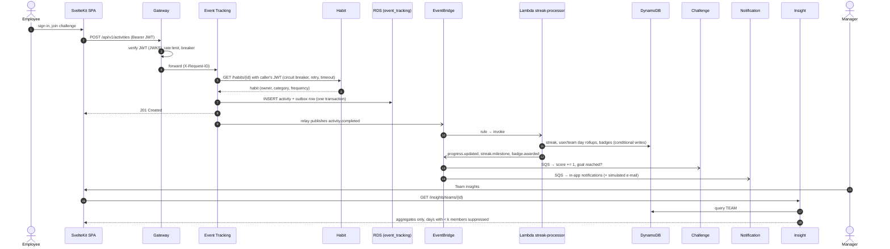

# TeamPulse — Microservices Design Document

## 1. Goals and constraints

| Business goal | Architectural consequence |
|---|---|
| Employees build healthy habits and compete in team challenges | habit, activity, challenge and streak capabilities as independently scalable services |
| …without exposing personal data broadly | private-by-default data, owner-only reads, k-anonymised manager views, PII-free events |
| Large organisation: access control and scale | RS256 JWT + RBAC at edge *and* in every service, stateless services, async event processing |

## 2. Bounded contexts and data ownership

Each service owns its data; no service reads another's database (database-per-service). Cross-context
data travels through **events** (eventual consistency) or an explicit synchronous API call.

| Service | Owns | Writes events | Consumes events | Sync calls out |
|---|---|---|---|---|
| identity | users, teams, refresh tokens | `user.registered`, `user.updated` | — | — |
| habit | habits (+ denormalised owner name/team) | — | `user.updated` | — |
| event-tracking | activities (completions) | `activity.completed` | — | habit (ownership/visibility check) |
| streak-processor (Lambda) | analytics table (streaks, badges, rollups) | `progress.updated`, `streak.milestone`, `badge.awarded` | `activity.completed`, `badge_rules.changed` | — |
| challenge | challenges, participants, badge rules | `challenge.created/joined/goal_reached`, `badge_rules.changed` | `progress.updated` | — |
| insight | *(read model only)* | — | — (reads DynamoDB) | — |
| notification | notifications, preferences, contact projection | — | user, activity, streak, badge, challenge, `reminder.tick` | — |
| gateway | — | — | — | all (routing) |

**CQRS:** event-tracking is the *command* side for activity; the streak processor builds a *read
model* in DynamoDB; insight-service is the *query* side. This keeps the write path fast and lets
analytics scale independently (DynamoDB on-demand, Lambda concurrency).

## 3. End-to-end flow (case study)

## 4. Cross-cutting concerns (shared chassis `libs/common`)

All services are created by one factory (`create_service_app`) so concerns behave identically:

| Concern | Implementation |
|---|---|
| Authentication | RS256 JWT issued by identity (15 min) + rotating opaque refresh tokens (7 days, reuse ⇒ family revoked); public key via JWKS; verified at the gateway **and** in each service |
| Authorization | `Role` (employee/manager/admin) + `require_roles`; ownership/team checks in domain services; 404 (not 403) for private resources |
| Error handling | global handlers → RFC 7807 `application/problem+json` with `code` and `request_id`; validation errors list fields |
| Logging | JSON (CloudWatch/ELK) or console; `request_id`, `user_id`, `trace_id` from context vars; secrets/notes redacted |
| Metrics | CloudWatch Embedded Metric Format (`TeamPulse/RequestLatency`) from the access-log middleware |
| Tracing | OpenTelemetry (FastAPI + httpx instrumentation, W3C `traceparent`), OTLP → Jaeger / ADOT |
| Correlation | `X-Request-ID` accepted/generated, propagated to upstreams and into event envelopes |
| Resilience | circuit breaker (closed/open/half-open), retry with exponential backoff + jitter for idempotent calls, timeouts, fail-fast 503 |
| Messaging | transactional outbox (no dual write), idempotent inbox (`processed_events`), DLQs |
| Discovery | Consul self-registration + gateway resolution (Docker); ECS Service Connect DNS (AWS) |
| Health | `/health/live`, `/health/ready` (DB/dependency checks), gateway `/health/services` |
| Edge protection | rate limiting (login stricter), body size limit, `/internal/**` blocked, hop-by-hop + spoofable headers stripped, security headers |
| Schema | Alembic migrations per service (`python -m <pkg>.migrate`), zero drift verified against models |
| Config | pydantic-settings from env; secrets injected by ECS from Secrets Manager |

## 5. Runtime topologies

| Concern | Local (`run_local.py`) | Docker Compose | AWS |
|---|---|---|---|
| Relational data | SQLite file per service | Postgres, db per service | RDS PostgreSQL, db + login per service |
| Analytics | SQLite emulating the single table | DynamoDB Local | DynamoDB |
| Event bus | `direct` HTTP fan-out (`EVENT_ROUTES`) | RabbitMQ topic exchange + queue/DLQ per consumer | EventBridge bus + rules → SQS (+DLQ) / Lambda |
| Streak processor | worker process | worker container | **Lambda** (container image) |
| Discovery | static URLs | Consul | ECS Service Connect |
| Tracing | off | Jaeger | ADOT / X-Ray (optional) |
| Reminders | in-process scheduler | in-process scheduler | EventBridge Scheduler → `reminder.tick` |

The same code runs everywhere; only adapters (ports & adapters) change via configuration.

## 6. Frontend architecture

* **SvelteKit + Svelte 5 runes** SPA (`adapter-static`), file-based routes:
  `/dashboard`, `/habits` (`/new`, `/[id]`, `/[id]/edit`, `/team`), `/challenges` (`/new`, `/[id]`),
  `/analytics`, `/team` (managers), `/admin/{users,teams,badge-rules,insights}`, `/notifications`, `/profile`.
* **Role-based navigation and guards** in `+layout.ts` load functions (role from the JWT).
* Shared state in `*.svelte.ts` rune modules (session, notifications, toasts, URL-synced filters).
* **Reusable web components** (`@teampulse/ui-components`, StencilJS): `tp-leaderboard-table`,
  `tp-progress-ring`, `tp-progress-card`, `tp-trend-chart`, `tp-badge`, `tp-stat-tile` — props in,
  `tp-*` custom events out, slots, consumed as an npm package.
* **Design tokens governed centrally** in the library (`tokens.css`, light/dark) and consumed by the app.
* Details: [frontend/README.md](../frontend/README.md), [frontend/web/README.md](../frontend/web/README.md).

## 7. Key design decisions

| Decision | Why | Trade-off |
|---|---|---|
| RS256 + JWKS instead of a shared HMAC secret | only identity can mint tokens; others hold a public key | key distribution/caching; rotation via `kid` |
| Transactional outbox + idempotent inbox | no lost or phantom events, safe redelivery | extra tables, eventual consistency (≈ 1 s) |
| Event-carried state (badge rules, habit frequency in events) | Lambda needs no synchronous calls | payloads must be versioned |
| Streak recomputed from bounded history | correct with out-of-order/duplicate events | stores ≤ 400 dates per habit |
| DynamoDB single table for analytics | predictable key access, on-demand scale, TTL for idempotency keys | access patterns fixed up front |
| k-anonymity (k = 3) for manager views, incl. zero days | managers cannot infer any individual | sparse charts for small teams |
| Gateway in front of services (vs ALB path routing only) | one place for auth, rate limiting, breakers, docs | one extra hop |

### Case-study trade-offs, revisited
* *Engagement & cross-team visibility vs permission boundaries* → leaderboards are opt-in by name
  (`show_on_leaderboard`), team habits are opt-in (`visibility=team`), managers get aggregates only.
* *Reusable web components vs central design tokens* → tokens live in the library and are versioned
  with it; components use only `--tp-*` variables.
* *Private networking & role separation vs complexity* → three subnet tiers, one IAM role pair per
  service; complexity contained by the shared chassis and the step-by-step AWS guide.
