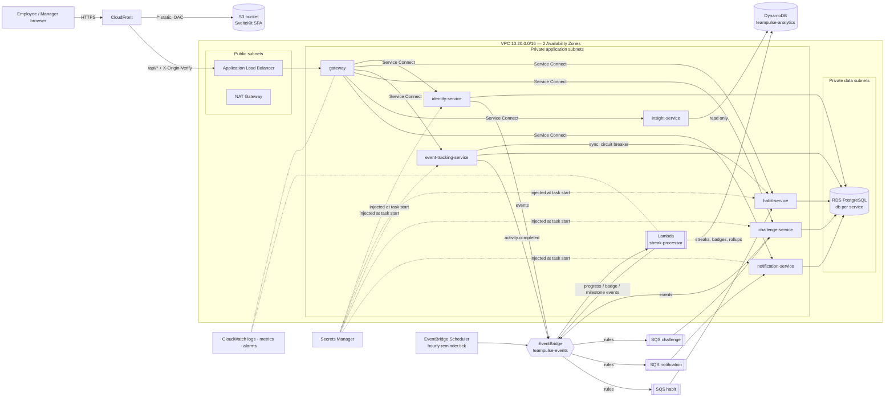

# TeamPulse — AWS Deployment Guide (manual, step by step)

This guide provisions the whole case-study architecture by hand in the AWS Management Console (plus a
few CLI commands for building/pushing images). Every copy-paste artefact referenced below lives in
[`deploy/aws/`](../deploy/aws). Follow the steps **in order** — later steps reference resources created
earlier.

> **Cost warning.** NAT Gateway, ALB, Fargate tasks and interface VPC endpoints are **not** free tier.
> A full dev stack costs roughly **US$4 per day** (≈ $120/month). Do the
> [clean-up](#16-clean-up-avoid-charges) when you no longer need it. Set a budget alert in step 1.

## Contents
0. [Architecture & naming](#0-architecture--naming)
1. [Account, IAM users and groups](#1-account-iam-users-and-groups)
2. [Networking: VPC, subnets, routing, NAT](#2-networking-vpc-subnets-routing-nat)
3. [Security groups and network ACLs](#3-security-groups-and-network-acls)
4. [VPC endpoints (private access to AWS services)](#4-vpc-endpoints-private-access-to-aws-services)
5. [Secrets Manager](#5-secrets-manager)
6. [Data: RDS PostgreSQL and DynamoDB](#6-data-rds-postgresql-and-dynamodb)
7. [Container images in ECR](#7-container-images-in-ecr)
8. [Messaging: EventBridge bus, SQS queues, rules, scheduler](#8-messaging-eventbridge-bus-sqs-queues-rules-scheduler)
9. [IAM roles for workloads (least privilege)](#9-iam-roles-for-workloads-least-privilege)
10. [Lambda: streak processor](#10-lambda-streak-processor)
11. [Load balancer](#11-application-load-balancer)
12. [ECS cluster, database migrations, services, auto scaling](#12-ecs-cluster-migrations-services-auto-scaling)
13. [Frontend: S3 + CloudFront](#13-frontend-s3--cloudfront)
14. [Observability: CloudWatch logs, metrics, dashboard, alarms](#14-observability-cloudwatch)
15. [Verify the end-to-end flow](#15-verify-the-end-to-end-flow) · [Clean-up](#16-clean-up-avoid-charges) · [Troubleshooting](#17-troubleshooting)

---

## 0. Architecture & naming



**Region.** Examples use `ap-south-1` (Mumbai). Any region works — use the same one everywhere.

| Resource | Name used in this guide |
|---|---|
| VPC | `teampulse-vpc` (10.20.0.0/16) |
| Subnets | `teampulse-public-a/b`, `teampulse-app-a/b`, `teampulse-data-a/b` |
| ECS cluster / namespace | `teampulse` / `teampulse.local` |
| ECS services (= container names = Service Connect names) | `gateway`, `identity-service`, `habit-service`, `event-tracking-service`, `challenge-service`, `insight-service`, `notification-service` |
| Lambda | `teampulse-streak-processor` |
| ECR repositories | `teampulse/<service>` (7) and `teampulse/streak-processor-lambda` |
| RDS instance | `teampulse-db` |
| DynamoDB table | `teampulse-analytics` (keys `pk`, `sk`) |
| EventBridge bus | `teampulse-events` |
| SQS queues | `teampulse-{challenge,notification,habit}-events` (+ `-dlq`), `teampulse-streak-processor-dlq` |
| Secrets | `teampulse/identity/jwt-private-key`, `teampulse/<db>/db-password` |

**Placeholders.** Files in `deploy/aws/` contain `<ACCOUNT_ID>`, `<REGION>`, `<IMAGE_TAG>`, `<RDS_ENDPOINT>`,
`<CLOUDFRONT_DOMAIN>` etc. Replace them before pasting (a find-and-replace in your editor is enough).

**Tools on your machine:** AWS CLI v2 (configured with the deployer user from step 1), Docker Desktop
(for building images), Node 20+ (frontend build). Run the shell snippets in Git Bash, WSL or macOS/Linux
terminal; AWS CloudShell works for everything except `docker build`.

```bash
export AWS_REGION=ap-south-1
export ACCOUNT_ID=$(aws sts get-caller-identity --query Account --output text)
export REGISTRY=$ACCOUNT_ID.dkr.ecr.$AWS_REGION.amazonaws.com
export TAG=v1.0.0          # immutable tags: bump for every release
```

---

## 1. Account, IAM users and groups

1. **Root account hygiene** – sign in as root once: enable **MFA** on root, then stop using it.
2. **Budget alarm** – *Billing → Budgets → Create budget → Cost budget*, e.g. US$20/month, alert at 80 %
   to your e-mail.
3. **IAM groups** (*IAM → User groups → Create group*):

   | Group | Permissions | Who |
   |---|---|---|
   | `teampulse-admins` | AWS managed `AdministratorAccess` | the person doing this setup (you) |
   | `teampulse-deployers` | inline policy [`deploy/aws/iam/group-teampulse-deployers.json`](../deploy/aws/iam/group-teampulse-deployers.json) (push to `teampulse/*` ECR repos, update ECS services, update the Lambda image, sync the frontend bucket, invalidate CloudFront, pass only `teampulse-*` roles) + `require-mfa.json` | CI / release engineer |
   | `teampulse-developers` | AWS managed `ReadOnlyAccess` + `CloudWatchLogsReadOnlyAccess` + [`require-mfa.json`](../deploy/aws/iam/require-mfa.json) | developers (observe, debug — no changes) |

   The deployers policy references the frontend bucket and distribution created in step 13 — create it
   now with placeholders and edit it after step 13.
4. **Users** – *IAM → Users → Create user* for each team member, add to the right group, require a
   password reset. Every user enables MFA on first sign-in (the `require-mfa` policy denies everything
   else until they do). Create an **access key** only for the deployer user you will use with the CLI.

> Principle of least privilege: nobody except `teampulse-admins` can create or delete infrastructure;
> deployers can only ship new versions of *TeamPulse* resources; developers are read-only.

---

## 2. Networking: VPC, subnets, routing, NAT

Three tiers × two AZs = **separate VPC segments for public access, application workloads and data
services** (case-study requirement).

1. *VPC → Your VPCs → Create VPC → "VPC only"*: name `teampulse-vpc`, IPv4 CIDR `10.20.0.0/16`.
   After creation: *Actions → Edit VPC settings* → enable **DNS resolution** and **DNS hostnames**
   (required by RDS, Service Connect and interface endpoints).
2. *Subnets → Create subnet* (VPC `teampulse-vpc`) — six subnets in two AZs:

   | Name | AZ | CIDR | Tier |
   |---|---|---|---|
   | `teampulse-public-a` | `<REGION>a` | 10.20.0.0/24 | public (ALB, NAT) |
   | `teampulse-public-b` | `<REGION>b` | 10.20.1.0/24 | public |
   | `teampulse-app-a` | `<REGION>a` | 10.20.10.0/24 | private application (ECS tasks, Lambda) |
   | `teampulse-app-b` | `<REGION>b` | 10.20.11.0/24 | private application |
   | `teampulse-data-a` | `<REGION>a` | 10.20.20.0/24 | private data (RDS) |
   | `teampulse-data-b` | `<REGION>b` | 10.20.21.0/24 | private data |

   Leave *auto-assign public IPv4* **off** on all six (the ALB gets public addresses by itself).
3. *Internet gateways → Create* `teampulse-igw` → *Attach to VPC* `teampulse-vpc`.
4. *NAT gateways → Create*: name `teampulse-nat-a`, subnet `teampulse-public-a`, connectivity *Public*,
   *Allocate Elastic IP*. (For production HA create a second one in `public-b` and a per-AZ app route
   table; one NAT is fine for a demo. To avoid NAT entirely see step 4, option B.)
5. *Route tables → Create* three tables and associate subnets:

   | Route table | Routes | Associated subnets |
   |---|---|---|
   | `teampulse-public-rt` | `0.0.0.0/0 → teampulse-igw` | public-a, public-b |
   | `teampulse-app-rt` | `0.0.0.0/0 → teampulse-nat-a` (+ S3/DynamoDB gateway endpoints from step 4) | app-a, app-b |
   | `teampulse-data-rt` | local only — **no internet route** | data-a, data-b |

---

## 3. Security groups and network ACLs

### 3.1 Security groups (stateful) — *VPC → Security groups → Create*

Create them in this order (later rules reference earlier groups). Remove nothing from outbound unless
stated.

| Security group | Inbound rules | Purpose |
|---|---|---|
| `teampulse-alb-sg` | 443/TCP from `0.0.0.0/0`; 80/TCP from `0.0.0.0/0` | Internet → ALB only |
| `teampulse-gateway-sg` | 8000/TCP from `teampulse-alb-sg` | only the ALB can reach the gateway |
| `teampulse-services-sg` | 8000/TCP from `teampulse-gateway-sg`; 8000/TCP from `teampulse-services-sg` (self, east-west via Service Connect) | internal microservices |
| `teampulse-lambda-sg` | *(none)* | Lambda only makes outbound calls |
| `teampulse-rds-sg` | 5432/TCP from `teampulse-services-sg` | **only** the services with a database |
| `teampulse-endpoints-sg` | 443/TCP from `10.20.0.0/16` | interface VPC endpoints (step 4) |

> The gateway task joins **both** `teampulse-gateway-sg` and `teampulse-services-sg` (it must call the
> services). Nothing in the public tier can open a connection to RDS.

### 3.2 Network ACLs (stateless, subnet level) — *VPC → Network ACLs → Create*

Create three NACLs, associate them with the matching subnets, and replace the default rules with:

**`teampulse-public-nacl`** (public-a/b)

| Dir | # | Protocol / ports | Source / destination | Action |
|---|---|---|---|---|
| In | 100 | TCP 443 | 0.0.0.0/0 | ALLOW |
| In | 110 | TCP 80 | 0.0.0.0/0 | ALLOW |
| In | 120 | TCP 1024-65535 (return traffic, NAT) | 0.0.0.0/0 | ALLOW |
| Out | 100 | TCP 8000 | 10.20.10.0/23 (app subnets) | ALLOW |
| Out | 110 | TCP 443 | 0.0.0.0/0 | ALLOW |
| Out | 120 | TCP 1024-65535 | 0.0.0.0/0 | ALLOW |

**`teampulse-app-nacl`** (app-a/b)

| Dir | # | Protocol / ports | Source / destination | Action |
|---|---|---|---|---|
| In | 100 | TCP 8000 | 10.20.0.0/16 | ALLOW |
| In | 110 | TCP 1024-65535 (return traffic) | 0.0.0.0/0 | ALLOW |
| In | 120 | TCP 443 (endpoints) | 10.20.0.0/16 | ALLOW |
| Out | 100 | TCP 443 | 0.0.0.0/0 | ALLOW |
| Out | 110 | TCP 5432 | 10.20.20.0/23 (data subnets) | ALLOW |
| Out | 120 | TCP 8000 | 10.20.0.0/16 | ALLOW |
| Out | 130 | TCP 1024-65535 | 0.0.0.0/0 | ALLOW |

**`teampulse-data-nacl`** (data-a/b)

| Dir | # | Protocol / ports | Source / destination | Action |
|---|---|---|---|---|
| In | 100 | TCP 5432 | 10.20.10.0/23 (app subnets only) | ALLOW |
| Out | 100 | TCP 1024-65535 | 10.20.10.0/23 | ALLOW |

(Every NACL ends with the implicit `*  DENY`.)

---

## 4. VPC endpoints (private access to AWS services)

*VPC → Endpoints → Create endpoint*

**Always create (free) gateway endpoints** — select route table `teampulse-app-rt`:
- `com.amazonaws.<REGION>.s3` (ECR image layers are stored in S3)
- `com.amazonaws.<REGION>.dynamodb` (Lambda + insight-service reach DynamoDB without NAT)

**Option A — keep the NAT gateway (simplest, recommended for the demo).** Nothing else needed.

**Option C — NAT instance instead of a NAT gateway (cheapest; used by the live demo).** Skip the NAT
gateway in step 2.4. Create security group `teampulse-nat-sg` (all traffic from `10.20.0.0/16`), then
launch a `t4g.micro` Amazon Linux 2023 instance `teampulse-nat-a` in `teampulse-public-a` with a public
IP, that security group, no key pair, and this user data:

```bash
#!/bin/bash
dnf install -y iptables-services && systemctl enable --now iptables
echo 'net.ipv4.ip_forward = 1' > /etc/sysctl.d/90-nat.conf && sysctl --system
IFACE=$(ip -o -4 route show to default | awk '{print $5}' | head -1)
iptables -t nat -A POSTROUTING -o "$IFACE" -s 10.20.0.0/16 -j MASQUERADE
iptables -F FORWARD && service iptables save
```

Then *Actions → Networking → Change source/destination check → Stop*, and point the
`teampulse-app-rt` route `0.0.0.0/0` at the instance. Create the network ACLs first (step 3): the
instance needs reply traffic allowed when it installs packages at first boot.

**Option B — no NAT, fully private (more secure, ~US$7/endpoint/AZ/month).** Delete the NAT route and
create *interface* endpoints in `teampulse-app-a/b` with security group `teampulse-endpoints-sg` and
*Private DNS* enabled for: `ecr.api`, `ecr.dkr`, `logs`, `secretsmanager`, `events`, `sqs`, `sts`,
`monitoring`. ECS tasks, Lambda and CloudShell-in-VPC then reach AWS APIs privately.

---

## 5. Secrets Manager

Secrets are injected into containers at start-up by ECS — never baked into images or stored in task
definitions as plain text. Each service can read **only its own** secrets (step 9).

```bash
# 5.1 JWT signing key (RS256). Only identity-service ever receives it.
openssl genpkey -algorithm RSA -pkeyopt rsa_keygen_bits:2048 -out jwt-private.pem
aws secretsmanager create-secret --name teampulse/identity/jwt-private-key \
  --description "TeamPulse RS256 signing key (identity-service only)" --secret-string file://jwt-private.pem
rm jwt-private.pem

# 5.2 One database password per service (plain-string secrets)
for db in identity habits event_tracking challenges notifications; do
  aws secretsmanager create-secret --name "teampulse/$db/db-password" \
    --secret-string "$(openssl rand -base64 30 | tr -dc 'A-Za-z0-9' | head -c 32)"
done
```

Console alternative: *Secrets Manager → Store a new secret → Other type of secret → Plaintext*.
Note each secret's **full ARN** (it ends in a random 6-character suffix) — you paste these into the task
definitions in step 12.

---

## 6. Data: RDS PostgreSQL and DynamoDB

### 6.1 RDS (transactional data)

1. *RDS → Subnet groups → Create*: `teampulse-db-subnets`, VPC `teampulse-vpc`, subnets **data-a, data-b**.
2. *RDS → Parameter groups → Create*: family `postgres16`, name `teampulse-pg16` → edit → set
   `rds.force_ssl = 1` (TLS mandatory for every connection).
3. *RDS → Create database*:
   - Standard create · **PostgreSQL 16** · template *Free tier* (dev) or *Production* (HA)
   - Identifier `teampulse-db`, master username `postgres`
   - **Credentials management: "Managed in AWS Secrets Manager"** (master password never seen by you)
   - Instance `db.t4g.micro` (dev). For HA choose *Multi-AZ DB instance*.
   - Storage gp3 20 GiB, **encryption enabled**
   - Connectivity: VPC `teampulse-vpc`, subnet group `teampulse-db-subnets`, **Public access: No**,
     security group `teampulse-rds-sg` (remove `default`)
   - Additional configuration: DB parameter group `teampulse-pg16`, backups 7 days,
     enable *deletion protection* for prod (leave off for a demo you will delete)
4. When *Available*, copy the **endpoint** (`teampulse-db.xxxx.<REGION>.rds.amazonaws.com`) → `<RDS_ENDPOINT>`.

### 6.2 Bootstrap one database + one login per service

RDS is private, so run SQL from inside the VPC with **CloudShell VPC environment**:

1. *CloudShell → Actions → Create VPC environment*: VPC `teampulse-vpc`, subnet `teampulse-app-a`,
   security group `teampulse-services-sg` (it is allowed into RDS).
2. *Actions → Upload file* → `deploy/aws/rds/bootstrap.sql`, then:

```bash
sudo dnf install -y postgresql15
MASTER_SECRET=$(aws rds describe-db-instances --db-instance-identifier teampulse-db \
  --query 'DBInstances[0].MasterUserSecret.SecretArn' --output text)
export PGPASSWORD=$(aws secretsmanager get-secret-value --secret-id "$MASTER_SECRET" \
  --query SecretString --output text | python3 -c 'import json,sys; print(json.load(sys.stdin)["password"])')
pw() { aws secretsmanager get-secret-value --secret-id "teampulse/$1/db-password" --query SecretString --output text; }
psql "host=<RDS_ENDPOINT> port=5432 dbname=postgres user=postgres sslmode=require" \
  -v identity_pw="$(pw identity)" -v habits_pw="$(pw habits)" -v event_tracking_pw="$(pw event_tracking)" \
  -v challenges_pw="$(pw challenges)" -v notifications_pw="$(pw notifications)" -f bootstrap.sql
unset PGPASSWORD
```

Result: databases `identity, habits, event_tracking, challenges, notifications`, each owned by its own
login (`identity_svc`, `habits_svc`, …). Tables are created later by Alembic migrations (step 12.3).

### 6.3 DynamoDB (event-driven, high-throughput analytics)

*DynamoDB → Create table*: name **`teampulse-analytics`**, partition key **`pk`** (String), sort key
**`sk`** (String), *Customize settings* → capacity **On-demand**, encryption *Owned by Amazon DynamoDB*
(or AWS managed key). After creation: *Backups → Point-in-time recovery: On*;
*Additional settings → Time to Live → attribute `expires_at`* (idempotency markers expire after 7 days).

Single-table layout (written only by the Lambda, read only by insight-service) — see
[`docs/events.md`](events.md#analytics-single-table-dynamodb-teampulse-analytics).

---

## 7. Container images in ECR

1. *ECR → Private registry → Create repository* (×8): `teampulse/gateway`, `teampulse/identity-service`,
   `teampulse/habit-service`, `teampulse/event-tracking-service`, `teampulse/challenge-service`,
   `teampulse/insight-service`, `teampulse/notification-service`, `teampulse/streak-processor-lambda`.
   For each: **Tag immutability: Immutable**, **Scan on push: On**, encryption AES-256 (or KMS).
   *Lifecycle policy* → rule "keep last 20 images".
2. Build and push from the repository root (Docker Desktop running):

```bash
aws ecr get-login-password --region $AWS_REGION | docker login --username AWS --password-stdin $REGISTRY

for svc in gateway identity-service habit-service event-tracking-service challenge-service \
           insight-service notification-service; do
  docker buildx build --platform linux/amd64 -f services/$svc/Dockerfile \
    -t $REGISTRY/teampulse/$svc:$TAG --push .
done

# Lambda container image (Lambda needs a single-platform manifest → --provenance=false)
docker buildx build --platform linux/amd64 --provenance=false -f services/streak-processor/Dockerfile.lambda \
  -t $REGISTRY/teampulse/streak-processor-lambda:$TAG --push .
```

Check *ECR → repository → Images*: the scan should show no critical findings.

---

## 8. Messaging: EventBridge bus, SQS queues, rules, scheduler

### 8.1 Bus
*EventBridge → Event buses → Create*: name **`teampulse-events`**. Optionally *Create archive* (retain
7 days) so events can be **replayed** after a consumer bug fix.

### 8.2 SQS queues (one per consuming ECS service, each with a DLQ)
*SQS → Create queue* (Standard, encryption *SSE-SQS*):

| Queue | Settings |
|---|---|
| `teampulse-challenge-events-dlq`, `teampulse-notification-events-dlq`, `teampulse-habit-events-dlq`, `teampulse-streak-processor-dlq` | retention 14 days |
| `teampulse-challenge-events` | visibility timeout 60 s, receive wait 20 s, **Dead-letter queue** → `teampulse-challenge-events-dlq`, max receives 5 |
| `teampulse-notification-events` | same, DLQ `teampulse-notification-events-dlq` |
| `teampulse-habit-events` | same, DLQ `teampulse-habit-events-dlq` |

### 8.3 Rules (event routing) — *EventBridge → Rules → Create rule*, bus `teampulse-events`

Choose *Rule with an event pattern → Custom pattern (JSON editor)* and paste:

| Rule name | Event pattern file | Target |
|---|---|---|
| `to-challenge-service` | [`rule-challenge-service.json`](../deploy/aws/eventbridge/rule-challenge-service.json) | SQS `teampulse-challenge-events` |
| `to-notification-service` | [`rule-notification-service.json`](../deploy/aws/eventbridge/rule-notification-service.json) | SQS `teampulse-notification-events` |
| `to-habit-service` | [`rule-habit-service.json`](../deploy/aws/eventbridge/rule-habit-service.json) | SQS `teampulse-habit-events` |
| `to-streak-processor` | [`rule-streak-processor.json`](../deploy/aws/eventbridge/rule-streak-processor.json) | Lambda — **create in step 10.3** |

For each SQS target, open the queue → *Access policy* and make sure it matches
[`sqs-queue-policy.json`](../deploy/aws/eventbridge/sqs-queue-policy.json) — only that rule may send
(`aws:SourceArn` condition). The console usually adds this for you; verify it.

Each event arrives in the queue as the full EventBridge event; the services unwrap `detail` (the
TeamPulse envelope) automatically.

### 8.4 Hourly reminders — *EventBridge → Scheduler → Schedules → Create schedule*
- Name `teampulse-reminder-tick`, recurring, **cron `0 * * * ? *`** (every hour), flexible window off
- Target: **Amazon EventBridge → PutEvents**, bus `teampulse-events`, *Detail-type* `reminder.tick`,
  *Source* `teampulse.scheduler`, *Detail*: paste the single line from
  [`scheduler-reminder-detail.json`](../deploy/aws/eventbridge/scheduler-reminder-detail.json)
  (keep `<aws.scheduler.execution-id>` / `<aws.scheduler.scheduled-time>` literally — Scheduler fills them)
- Permissions: *Create new role for this schedule*

notification-service then reminds people at **their own local hour**, only if they have not logged
anything that day.

---

## 9. IAM roles for workloads (least privilege)

*IAM → Roles → Create role → Custom trust policy*. Policy files are in
[`deploy/aws/iam/`](../deploy/aws/iam); replace the placeholders.

### 9.1 Task execution roles (used by ECS to pull images, write logs, inject secrets)
Trust policy [`trust-ecs-tasks.json`](../deploy/aws/iam/trust-ecs-tasks.json). Create one per service
named `teampulse-<service>-execution`, each with:
- AWS managed policy **`AmazonECSTaskExecutionRolePolicy`**
- for services **with** secrets, inline [`execution-read-own-secrets.json`](../deploy/aws/iam/execution-read-own-secrets.json)
  with `<SECRET_PREFIX>` = `identity`, `habits`, `event_tracking`, `challenges` or `notifications`.
  (`gateway` and `insight-service` get no secret access at all.)

### 9.2 Task roles (what the application code may call)

| Role | Inline policies |
|---|---|
| `teampulse-gateway-task` | *none* |
| `teampulse-identity-service-task` | `task-publish-events.json` |
| `teampulse-habit-service-task` | `task-consume-queue.json` (`<QUEUE_NAME>` = `teampulse-habit-events`) |
| `teampulse-event-tracking-service-task` | `task-publish-events.json` |
| `teampulse-challenge-service-task` | `task-publish-events.json` + `task-consume-queue.json` (`teampulse-challenge-events`) |
| `teampulse-insight-service-task` | `task-insight-dynamodb-read.json` (Get/Query only — cannot write analytics) |
| `teampulse-notification-service-task` | `task-consume-queue.json` (`teampulse-notification-events`) |

### 9.3 Lambda role `teampulse-streak-processor-lambda`
Trust [`trust-lambda.json`](../deploy/aws/iam/trust-lambda.json) + managed
**`AWSLambdaVPCAccessExecutionRole`** + inline [`lambda-streak-processor.json`](../deploy/aws/iam/lambda-streak-processor.json)
(read/write the analytics table, publish to the bus, send to its DLQ — nothing else).

---

## 10. Lambda: streak processor

1. *Lambda → Create function → Container image*: name **`teampulse-streak-processor`**, image
   `teampulse/streak-processor-lambda:<TAG>`, architecture **x86_64**, execution role
   `teampulse-streak-processor-lambda`.
2. *Configuration*:
   - General: memory **512 MB**, timeout **30 s**
   - Environment variables: `ENVIRONMENT=aws`, `LOG_LEVEL=INFO`, `EVENT_BUS_NAME=teampulse-events`,
     `ANALYTICS_TABLE_NAME=teampulse-analytics` (`ANALYTICS_STORE_DRIVER=dynamodb` and
     `EVENT_BUS_DRIVER=eventbridge` are baked into the image)
   - VPC: `teampulse-vpc`, subnets **app-a, app-b**, security group `teampulse-lambda-sg`
   - Concurrency: reserved **10** (protects RDS/DynamoDB from bursts)
   - Asynchronous invocation: retry attempts **2**, on-failure destination **SQS
     `teampulse-streak-processor-dlq`**
3. **Trigger**: open rule `to-streak-processor` (step 8.3) → target *Lambda function*
   `teampulse-streak-processor`; *Additional settings*: retry max age 1 h, dead-letter queue
   `teampulse-streak-processor-dlq`. The console adds the resource-based permission for EventBridge.
4. Smoke test: *Lambda → Test* with this event (an EventBridge event wrapping a TeamPulse envelope of a
   type the processor ignores, so nothing is written). Expect `{"status": "ok", …}` and a
   `lambda.processed` line in `/aws/lambda/teampulse-streak-processor`, which proves the image, role and
   VPC wiring work:

```json
{"version":"0","id":"t-1","detail-type":"smoke.test","source":"teampulse.manual","detail":
 {"type":"smoke.test","source":"manual","data":{}}}
```

---

## 11. Application Load Balancer

1. *EC2 → Target groups → Create*: type **IP addresses**, name `teampulse-gateway-tg`, HTTP **8000**,
   VPC `teampulse-vpc`, health check path **`/health/live`**, healthy threshold 2, interval 15 s. Don't
   register targets (ECS does it).
2. *EC2 → Load balancers → Create → Application Load Balancer*: `teampulse-alb`, **internet-facing**,
   subnets **public-a, public-b**, security group `teampulse-alb-sg`. Attributes: *drop invalid header
   fields* = on; optionally access logs to an S3 bucket.
3. Listeners:
   - **With a domain + ACM certificate (recommended):** HTTPS:443 with policy
     `ELBSecurityPolicy-TLS13-1-2-2021-06`; HTTP:80 → *redirect to HTTPS*.
   - **Demo without a domain:** HTTP:80 only (CloudFront still serves the browser over HTTPS; the
     CloudFront→ALB hop is plain HTTP — acceptable for a demo only).
4. Lock the ALB to CloudFront: listener **default action = fixed response 403**, plus a rule
   *IF HTTP header `X-Origin-Verify` is `<a long random string>` THEN forward to `teampulse-gateway-tg`*.
   Keep the string — CloudFront sends it in step 13.

---

## 12. ECS cluster, migrations, services, auto scaling

### 12.1 Cluster
*ECS → Clusters → Create*: name **`teampulse`**, infrastructure **AWS Fargate**, *Service Connect
defaults* → namespace **`teampulse.local`** (creates the Cloud Map namespace), *Monitoring* →
**Container Insights on**.

### 12.2 Log groups and task definitions
1. *CloudWatch → Log groups → Create* `/ecs/teampulse/<service>` for the 7 services, retention 30 days.
2. *ECS → Task definitions → Create new → JSON*: paste each file from
   [`deploy/aws/task-definitions/`](../deploy/aws/task-definitions) after replacing `<ACCOUNT_ID>`,
   `<REGION>`, `<IMAGE_TAG>`, `<RDS_ENDPOINT>`, `<CLOUDFRONT_DOMAIN>` (use `example.cloudfront.net`
   for now, update after step 13) and the **full secret ARNs** from step 5.

Every task: Fargate 0.25 vCPU / 0.5 GB, non-root user, **read-only root filesystem** (only `/tmp`
writable), container health check on `/health/live`, JSON logs to CloudWatch, plain config as
environment variables and secrets from Secrets Manager.

### 12.3 Run database migrations (one-off tasks)
For each of identity, habit, event-tracking, challenge and notification:
*Cluster `teampulse` → Tasks → Run new task* → launch type Fargate → task definition
`teampulse-<service>` → networking: subnets **app-a/b**, security group `teampulse-services-sg`,
**public IP off** → *Container overrides* → command:

| Task definition | Command override |
|---|---|
| `teampulse-identity-service` | `python,-m,identity_service.migrate` |
| `teampulse-habit-service` | `python,-m,habit_service.migrate` |
| `teampulse-event-tracking-service` | `python,-m,event_tracking_service.migrate` |
| `teampulse-challenge-service` | `python,-m,challenge_service.migrate` |
| `teampulse-notification-service` | `python,-m,notification_service.migrate` |

Each task should stop with exit code 0 (logs show `Running upgrade -> <revision>, initial schema`).
Repeat this step whenever a release contains a new migration.

### 12.4 Services — *Cluster → Services → Create*, in this order
`identity-service` → `habit-service` → `event-tracking-service` → `challenge-service` →
`insight-service` → `notification-service` → **`gateway` last**.

For each:
- Compute: *Launch type* Fargate, platform LATEST; task definition `teampulse-<service>` (latest revision)
- Service name = the service name above; desired tasks **1** (dev) or **2** (HA, spread over 2 AZs)
- Deployment: rolling, **deployment circuit breaker with rollback = on**
- Networking: subnets **app-a, app-b**; security group `teampulse-services-sg`
  (gateway: `teampulse-gateway-sg` **and** `teampulse-services-sg`); **public IP off**
- **Service Connect: on**, namespace `teampulse.local`
  - backend services: *Client and server*, port alias `http`, discovery name and DNS = service name,
    port **8000** → reachable as `http://<service>:8000`
  - gateway: *Client side only*
- Load balancing (**gateway only**): ALB `teampulse-alb`, existing target group `teampulse-gateway-tg`,
  health-check grace period 60 s
- **Service auto scaling**: min 1 / max 4 (HA: min 2 / max 6),
  target tracking **ECSServiceAverageCPUUtilization = 60 %**; for gateway add a second policy
  **ALBRequestCountPerTarget = 500**.

identity-service seeds the demo organisation on first start (3 teams, 14 users, password
`TeamPulse@2026`; set `SEED_DEMO_DATA=false` for real use).

---

## 13. Frontend: S3 + CloudFront

1. **Bucket** – *S3 → Create bucket* `teampulse-frontend-<ACCOUNT_ID>`, *Block all public access* **on**,
   versioning on, default encryption SSE-S3.
2. **Build & upload** (API calls are same-origin `/api/...`, so no API URL is baked in):
   ```bash
   cd frontend/ui-components && npm ci && npm run build
   cd ../web && npm ci && npm run build
   aws s3 sync build/ s3://teampulse-frontend-$ACCOUNT_ID/ --delete \
     --cache-control "public,max-age=31536000,immutable" --exclude "index.html"
   aws s3 cp build/index.html s3://teampulse-frontend-$ACCOUNT_ID/index.html --cache-control "no-cache"
   ```
3. **CloudFront function** – *CloudFront → Functions → Create* `teampulse-spa-rewrite`, paste
   [`deploy/aws/cloudfront/spa-rewrite.js`](../deploy/aws/cloudfront/spa-rewrite.js), *Publish*.
4. **Distribution** – *CloudFront → Create distribution*:
   - Origin 1: the S3 bucket, **Origin access control (OAC)** → *Create new OAC* → after creation click
     *Copy policy* and paste it into the bucket policy (only this distribution may read the bucket)
   - Default behaviour: *Redirect HTTP to HTTPS*, cache policy *CachingOptimized*, response headers
     policy **SecurityHeadersPolicy**, *Function associations → Viewer request* →
     `teampulse-spa-rewrite`; default root object `index.html`; price class "use North America, Europe,
     Asia…" as you prefer; optionally attach **AWS WAF** (rate-based rule)
   - Origin 2 (*Origins → Create origin*): the ALB DNS name, protocol **HTTP only** (demo) or
     **HTTPS only** (with your domain), **custom header** `X-Origin-Verify: <string from step 11>`
   - Behaviours → *Create* for **`/api/*`** and **`/.well-known/*`** → origin = ALB, viewer protocol
     *HTTPS only*, allowed methods **GET, HEAD, OPTIONS, PUT, POST, PATCH, DELETE**, cache policy
     **CachingDisabled**, origin request policy **AllViewerExceptHostHeader**
5. Copy the distribution domain (`dxxxx.cloudfront.net`) → `<CLOUDFRONT_DOMAIN>`. Update `CORS_ORIGINS`
   in the task definitions (new revision) and update the services, and fill in the bucket/distribution
   in the deployers group policy (step 1).

Because the browser talks only to CloudFront (same origin for SPA and API), no CORS pre-flights occur in
normal use, and the ALB rejects any request that did not come through CloudFront.

---

## 14. Observability (CloudWatch)

All services write **JSON logs** (one object per line with `request_id`, `service`, `user_id`, event
names) and, with `METRICS_EMF=true`, CloudWatch **Embedded Metric Format** latency metrics
(`TeamPulse/RequestLatency` by `Service` and `StatusClass`).

1. **SNS** – *SNS → Topics → Create* `teampulse-alerts` (standard) → subscription *Email* → confirm the mail.
2. **Metric filter (authentication issues)** – *Log groups → `/ecs/teampulse/identity-service` →
   Metric filters → Create*: pattern **`{ $.event = "auth.login_failed" }`**, namespace `TeamPulse`,
   metric `AuthFailures`, value `1`.
3. **Dashboard** – *CloudWatch → Dashboards → Create* `TeamPulse` → *Actions → View/edit source* →
   paste [`deploy/aws/cloudwatch/dashboard.json`](../deploy/aws/cloudwatch/dashboard.json) (replace
   `<REGION>` and `<ALB_ID>` = the part after `loadbalancer/` in the ALB ARN, e.g. `app/teampulse-alb/123abc`).
4. **Alarms** (*Alarms → Create alarm*, action → `teampulse-alerts`):

   | Alarm | Metric | Condition |
   |---|---|---|
   | API latency | `AWS/ApplicationELB TargetResponseTime` p95 | > 1 s for 3 × 1 min |
   | API failures | `AWS/ApplicationELB HTTPCode_Target_5XX_Count` sum | > 10 in 5 min |
   | Authentication issues | `TeamPulse AuthFailures` sum | > 20 in 5 min (brute force) |
   | Queue depth | `AWS/SQS ApproximateNumberOfMessagesVisible` (each queue) | > 100 for 10 min |
   | Stuck consumers | `AWS/SQS ApproximateAgeOfOldestMessage` | > 300 s |
   | Poison messages | `AWS/SQS ApproximateNumberOfMessagesVisible` (each DLQ) | > 0 |
   | Lambda errors | `AWS/Lambda Errors` (`teampulse-streak-processor`) | > 0 in 5 min |
   | Service restarts | `ECS/ContainerInsights RunningTaskCount` (each service) | < desired for 5 min |
   | Database | `AWS/RDS CPUUtilization` | > 80 % for 10 min |

5. **Restart notifications** – *EventBridge → Rules* (on the **default** bus): pattern
   `{"source":["aws.ecs"],"detail-type":["ECS Task State Change"],"detail":{"clusterArn":["<cluster ARN>"],"lastStatus":["STOPPED"]}}`
   → target SNS `teampulse-alerts`.
6. Useful **Logs Insights** queries (select all `/ecs/teampulse/*` groups):
   ```
   fields @timestamp, service, level, message, request_id | filter request_id = "<id from X-Request-ID>" | sort @timestamp
   fields @timestamp, service, status, duration_ms, path | filter message = "request.completed" and status >= 500
   stats count() by reason | filter event = "auth.login_failed"
   ```

---

## 15. Verify the end-to-end flow

Open `https://<CLOUDFRONT_DOMAIN>` and walk the case-study flow:

| # | Case-study step | What to do | Where to see it |
|---|---|---|---|
| 1 | Employee signs in and joins a challenge | log in as `alice.johnson@teampulse.io` / `TeamPulse@2026`, open *Challenges*, join one | identity log `auth.login_succeeded`; challenge DB |
| 2 | Frontend renders goals & team progress | Dashboard shows habits, progress rings, challenge cards | browser |
| 3 | Completion captured & stored in RDS | create a habit, click **Complete** | event-tracking log `request.completed 201`; `SELECT * FROM activities` (CloudShell, db `event_tracking`) |
| 4 | Events published to EventBridge | — | event-tracking log `outbox.published`; *EventBridge → bus → Monitoring* |
| 5 | Lambda computes streaks/badges/progress | — | `/aws/lambda/teampulse-streak-processor` → `processor.activity_processed` |
| 6 | Analytics stored in DynamoDB | — | *DynamoDB → teampulse-analytics → Explore items* (`USER#…`, `TEAM#…`) |
| 7 | Managers see only aggregates | log in as `maya.patel@teampulse.io` → *Team* | suppressed days for < 3 active members; no names |
| 8 | Notifications | bell icon → badge / milestone / challenge messages | notification-service log `notification.created` |
| 9 | CloudWatch collects everything | — | dashboard `TeamPulse`, alarms, Logs Insights |

Optional demo data (history + leaderboards) — run from your machine:
`uv run python scripts/seed_demo.py --gateway https://<CLOUDFRONT_DOMAIN> --days 7`
(7 = `ACTIVITY_BACKFILL_DAYS` in AWS). The gateway allows 10 logins/min per IP, so the seeder may
need a couple of runs; it skips users already seeded.

### Releasing a new version
Build and push with a new `TAG` (step 7) → *Task definitions → Create new revision* with the new image
→ run migrations if needed (12.3) → *Service → Update → Force new deployment* (the circuit breaker
rolls back automatically if health checks fail) → *Lambda → Deploy new image* → frontend `s3 sync` +
*CloudFront → Invalidations → `/index.html`*.

---

## 16. Clean-up (avoid charges)

Delete in this order, then check *Billing → Bills* and *Cost Explorer* the next day:

1. ECS services (set desired 0, then delete) → cluster `teampulse` → task definitions (deregister)
2. CloudFront distribution (disable, wait, delete) → CloudFront function → S3 bucket (empty, delete)
3. ALB → target group
4. Lambda function → EventBridge rules, Scheduler schedule, archive, bus → SQS queues
5. RDS `teampulse-db` (no final snapshot for a demo; disable deletion protection first)
   → subnet group → parameter group
6. DynamoDB table → ECR repositories (*force delete* removes images) → Secrets Manager secrets
   (schedule deletion, 7-day minimum)
7. **NAT gateway** → release its **Elastic IP** → interface VPC endpoints (if option B)
8. VPC `teampulse-vpc` (deletes subnets, route tables, NACLs, security groups, IGW)
9. CloudWatch dashboard, alarms, log groups, SNS topic; IAM roles/policies/users created here

---

## 17. Troubleshooting

| Symptom | Likely cause / fix |
|---|---|
| Task stuck in `PENDING` / `CannotPullContainerError` | app subnets have no route to ECR: NAT route missing, or (option B) `ecr.api`, `ecr.dkr`, `logs` endpoints or the **S3 gateway endpoint** missing |
| `ResourceInitializationError: unable to pull secrets` | wrong secret ARN in the task definition, or the execution role's `<SECRET_PREFIX>` does not match |
| Migration task fails with SSL / auth error | password secret differs from the one used in `bootstrap.sql`; RDS SG must allow `teampulse-services-sg` |
| Gateway returns 503 `dependency_unavailable` for one service | that service is unhealthy or not in Service Connect; check its logs, then *Force new deployment* of `gateway` so its proxy picks up the endpoint |
| Every API call returns 401 `jwks_unavailable` | identity-service not reachable at `http://identity-service:8000` (Service Connect name/port alias must be exactly `identity-service` / `http`) |
| ALB 403 when called directly | expected — only CloudFront (with `X-Origin-Verify`) is forwarded |
| Streaks/insights never update | rule `to-streak-processor` pattern/target; Lambda in VPC needs the DynamoDB gateway endpoint and NAT/`events` endpoint; check the Lambda DLQ |
| Notifications missing | `to-notification-service` rule → queue policy (`aws:SourceArn`); `EVENT_QUEUE_URL` correct; DLQ contents |
| Browser shows 404 on refresh of `/challenges/…` | CloudFront function not associated with the **default** behaviour (viewer request) |

---

### How the case-study AWS requirements map to this guide

| Case-study requirement | Implemented in |
|---|---|
| S3 hosting + global low-latency distribution | §13 (S3 private + CloudFront OAC, edge caching, HTTPS) |
| Separate VPC segments: public / application / data | §2 (3 tiers × 2 AZs), §3 (SGs + NACLs per tier) |
| ALB in public subnets → backends in private subnets | §11, §12.4 (only the ALB SG reaches the gateway) |
| ECS with Auto Scaling | §12 (Fargate, target tracking CPU + ALB requests, circuit-breaker rollback) |
| ECR private registry | §7 (immutable tags, scan on push, lifecycle) |
| RDS for transactional data, DynamoDB for event/analytics data | §6 (database per service, TLS forced; single-table DynamoDB) |
| EventBridge + Lambda for event-driven automation | §8, §10 (bus, rules, SQS fan-out with DLQs, archive/replay, Scheduler) |
| Secrets Manager + config separation | §5, §12.2 (secrets injected by ECS, config as env vars) |
| IAM least privilege per service | §1 (people), §9 (one execution + one task role per service, Lambda role) |
| SGs, NACLs, private subnets, HTTPS/TLS | §3, §2, §11, §13, `rds.force_ssl` |
| CloudWatch logs, metrics, dashboards, alerts (latency, API failures, auth issues, queue depth, restarts) | §14 |
