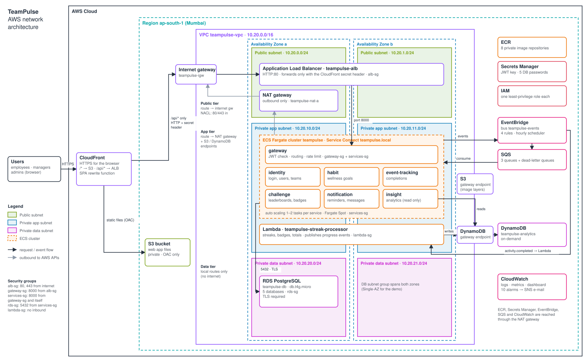

# Network architecture (AWS)

Editable source: [diagrams/network-architecture.drawio](diagrams/network-architecture.drawio) — open it
in https://app.diagrams.net or the draw.io app (*File → Export as → PNG* for slides).

## How a request travels

1. The browser talks only to **CloudFront**, over HTTPS.
2. Web app files come from a **private S3 bucket**; only CloudFront can read it (Origin Access Control).
3. `/api/*` calls go through the **internet gateway** to the **Application Load Balancer**. CloudFront
   adds a secret header; the ALB answers 403 to any request without it, so nobody can bypass CloudFront.
4. The ALB forwards to the **gateway** service (port 8000), which checks the JWT and calls the other
   services by name through **ECS Service Connect** (`http://habit-service:8000`).
5. Services with a database reach **RDS PostgreSQL** in the data subnets (port 5432, TLS required).
6. Services publish events to **EventBridge**. Rules send them to **SQS** queues (one per consuming
   service) or straight to the **Lambda**, which writes to **DynamoDB** through a free gateway endpoint.
7. Tasks have no public IP. They reach AWS APIs (ECR, Secrets Manager, CloudWatch, EventBridge, SQS)
   through the **NAT gateway**, outbound only.

## Subnets (VPC `10.20.0.0/16`, two Availability Zones)

| Tier | Zone a | Zone b | What runs there | Route to the internet |
|---|---|---|---|---|
| Public | 10.20.0.0/24 | 10.20.1.0/24 | ALB, NAT gateway | internet gateway |
| Private app | 10.20.10.0/24 | 10.20.11.0/24 | 7 ECS services, Lambda | NAT gateway (outbound only) + S3/DynamoDB gateway endpoints |
| Private data | 10.20.20.0/24 | 10.20.21.0/24 | RDS PostgreSQL | none |

## Security groups (stateful, per resource)

| Security group | Allows in | Attached to |
|---|---|---|
| `teampulse-alb-sg` | 80, 443 from the internet | ALB |
| `teampulse-gateway-sg` | 8000 from `alb-sg` | gateway task |
| `teampulse-services-sg` | 8000 from `gateway-sg` and from itself | all services (gateway too, so it can call them) |
| `teampulse-rds-sg` | 5432 from `services-sg` | RDS |
| `teampulse-lambda-sg` | nothing | Lambda (outbound calls only) |

## Network ACLs (stateless, per subnet)

| NACL | In | Out |
|---|---|---|
| public | 80, 443 and reply ports from anywhere | 8000 to the app subnets; 443 and reply ports to anywhere |
| app | 8000 from the VPC; reply ports | 443 to anywhere; 5432 to the data subnets; 8000 inside the VPC; reply ports |
| data | 5432 from the app subnets only | reply ports to the app subnets only |

So there are two layers of protection: even if a security group were opened by mistake, the data
subnets still accept nothing but PostgreSQL traffic from the app subnets.

## Demo settings versus production

| Production choice | Demo deployment | Why it is acceptable |
|---|---|---|
| One NAT gateway per zone | One NAT gateway | If that zone fails, private tasks lose outbound access |
| Interface endpoints for ECR, logs, Secrets Manager… | Only the free S3 and DynamoDB gateway endpoints | Other AWS API calls go through the NAT |
| HTTPS between CloudFront and the ALB (ACM certificate) | HTTP, locked by the secret header | Needs a custom domain; the browser → CloudFront hop is HTTPS |
| RDS Multi-AZ | Single-AZ (the subnet group already spans both zones) | No standby for demo data |
