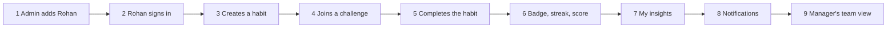

# User walkthrough — one employee's first day with TeamPulse

A new employee, **Rohan**, joins the Engineering team. He creates a habit, joins a challenge,
completes the habit, earns a badge and checks his progress. His manager, **Maya**, then looks at the
team's trends without seeing anything personal about Rohan.

Each step lists what you do, what you see, and what happens behind the screen.

**Before you start:** run the app ([setup guide](setup-guide.md)) and load the demo data, so the
challenge "Engineering Step-Up" exists. All demo passwords are `TeamPulse@2026`.

## 1. The admin adds Rohan

TeamPulse is an internal platform, so there is no public sign-up: an admin creates accounts.

- **Do:** sign in as `admin@teampulse.io` → **Users** → **+ New user**. Email
  `rohan.mehta@teampulse.io`, full name `Rohan Mehta`, initial password `Welcome2026`, role
  **Employee**, team **Engineering** → **Create user**.
- **See:** Rohan appears in the users table as an active employee.
- **Behind:** identity-service saves the user and publishes `user.registered`. notification-service
  receives it and prepares a welcome message.

## 2. Rohan signs in

- **Do:** sign out, then sign in as `rohan.mehta@teampulse.io` / `Welcome2026`.
- **See:** the dashboard: a greeting, four key-figure tiles (done today, completions, consistency,
  best streak), today's habits, a 14-day chart, streak milestones, active challenges and badges. The
  menu shows only what an employee may open (no Team insights, no Administration).
- **Behind:** identity-service checks the password and returns a signed token (RS256 JWT, valid 15
  minutes) with Rohan's role and team. Every service checks this token on each call.

## 3. He creates a habit

- **Do:** **My habits** → **+ New habit**: title `Morning walk`, activity type **Fitness**, frequency
  **Daily**, visibility **Private — only me** → **Create habit**.
- **See:** the habit in his list and in "Today's habits" on the dashboard.
- **Behind:** habit-service stores it. Private means only Rohan can see it; a **Team** habit would be
  visible to his teammates (the habit only, never his activity log).

## 4. He joins a challenge

- **Do:** **Challenges** → filter **Status: Active** and **Activity type: Fitness** → open
  **Engineering Step-Up** → keep **Show me on the leaderboard** ticked → **Join challenge**.
- **See:** the filters update the list as you choose (and the URL keeps them). After joining, "My
  progress" shows 0 of the target, and Rohan appears on the leaderboard.
- **Behind:** challenge-service records the entry and publishes `challenge.joined`. Rohan gets a "You
  joined “Engineering Step-Up”" notification.

## 5. He completes the habit

- **Do:** **Dashboard** → on the Morning walk card, **Mark complete**.
- **See:** a "Nice work!" message; the card shows **Done today** and "Done today" becomes 1/1.
- **Behind** (the main event flow):
  1. event-tracking-service asks habit-service whether the habit is Rohan's and active, then saves the
     completion in its database (RDS) together with an `activity.completed` event (outbox).
  2. The event goes to **EventBridge**, which starts the **streak processor (Lambda)**.
  3. The Lambda updates his streak (1 day), awards the badge **First Step**, adds the day to his and
     the team's totals in **DynamoDB**, and publishes `progress.updated` and `badge.awarded`.
  4. challenge-service adds 1 to his challenge score; notification-service creates
     "New badge: First Step 👣".

**Done twice?** The button is now disabled. The API also refuses a second completion of the same
habit on the same day (409 `already_logged`), so a day is never counted twice.

**Missed a day?** A day without a completion breaks the streak; the habit page then shows
"0 days (broken)" while keeping the longest streak. A forgotten day can still be logged on the habit
page (**Log a completion**, up to 7 days back), and the streak is recalculated.

## 6. Badge, streak and challenge score

- **Do:** open the challenge again, then the habit's page.
- **See:** "My progress" is 1 of the target and Rohan's leaderboard row shows 1 completion. The habit
  page shows the current streak, longest streak and the next milestone (3 days).
- **Behind:** after 3 days in a row the Lambda publishes `streak.milestone` (🔥 3-day streak!) and
  the badge **On a Roll**.

## 7. He checks his insights

- **Do:** **My insights**; try **Date range** and **Activity type**.
- **See:** completions, active days, consistency %, a daily chart (line or bars), a breakdown by
  activity type, streaks and badges. Only Rohan can see this page's data.
- **Behind:** insight-service reads the totals the Lambda wrote to DynamoDB; it never reads other
  services' databases.

## 8. Notifications and reminders

- **Do:** click the bell (top right).
- **See:** the welcome message, "You joined …", the badge, and later streak milestones. Under
  **Preferences** he turns on **Daily habit reminders** and picks a time and time zone.
- **Behind:** every hour EventBridge Scheduler sends `reminder.tick`; notification-service reminds
  the people whose chosen hour it is ("Time for your habits ⏰").

## 9. The manager's view (aggregated only)

- **Do:** sign in as `maya.patel@teampulse.io` → **Team insights**.
- **See:** a privacy notice, team totals, average active members and a daily trend. Days with fewer
  than 3 active members are hidden (hatched in the chart, counted as "Suppressed days"). The members
  list shows names and roles only, with no individual wellness data.
- **Try:** as Rohan, open `/team` directly: **Access denied**. The API also refuses (403), so hiding
  the menu link is not the only protection.

## How this maps to the case study's end-to-end flow

| Case study step | Walkthrough step |
|---|---|
| 1. Employee signs in and joins a wellness challenge | 2, 4 |
| 2. Frontend renders personal goals and team progress widgets | 2, 3, 6 |
| 3. Completion captured by Event Tracking and stored in RDS | 5 (1) |
| 4. Events published to EventBridge | 5 (2) |
| 5. Lambda calculates streaks, updates badges, triggers challenge progress | 5 (3–4), 6 |
| 6. Analytics stored in DynamoDB and aggregated per team | 5 (3), 7, 9 |
| 7. Managers see only aggregated trends | 9 |
| 8. Notification Service sends reminders and milestone messages | 1, 4, 5, 8 |
| 9. CloudWatch collects logs and metrics | every step: in AWS, search the `request_id` of any call in CloudWatch Logs Insights to see it in every service's log |
